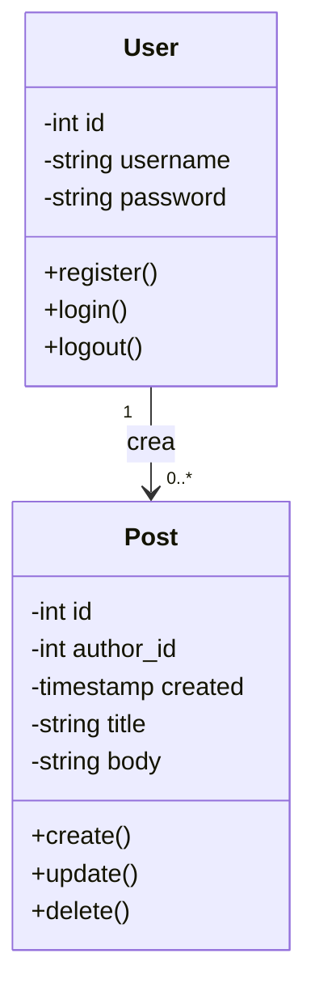

# Diagrama de clases UML — Flaskr

Este documento tiene como objetivo documentar el diagrama de clases UML del modelo de datos de la aplicación Flaskr (`User` y `Post`), mostrando sus atributos, métodos y relación 1:N.

